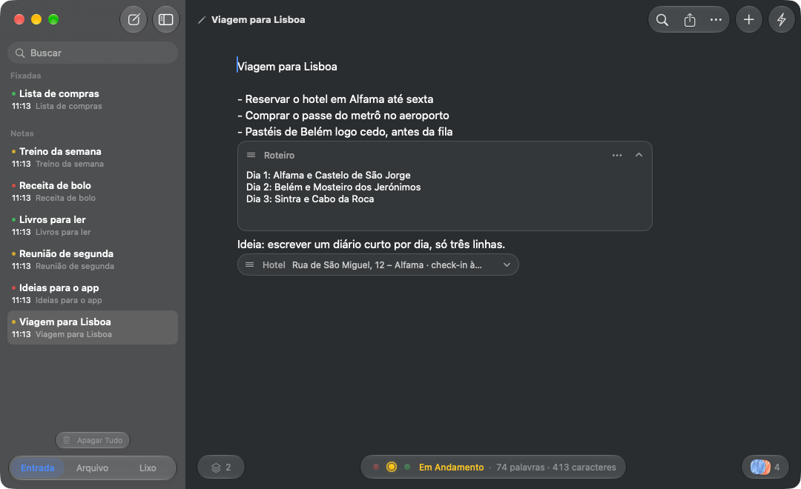
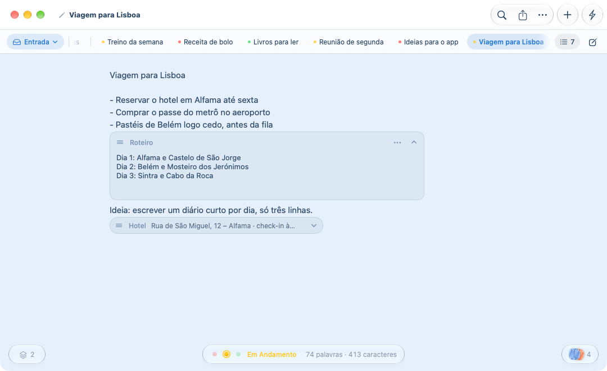
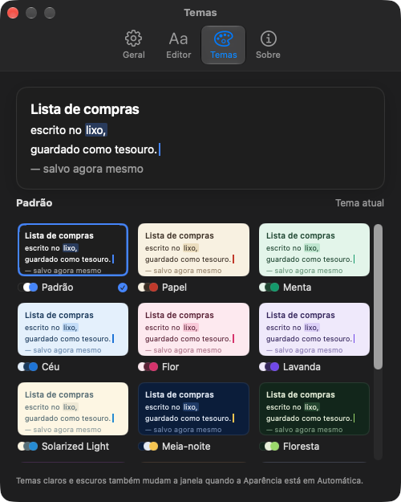

# Rubbish Notes

A plain-text notes app for macOS. Every note is a real `.txt` file, saved a moment after you stop typing. Paste anything and only the words arrive.



- **Note blocks** inside the text for longer passages: name them, fold them to one line, drag them between lines, copy or export them (plain text, PDF, Markdown).
- **Images and blocks in the footer**, kept apart from your writing. Images open in the app's own lightbox.
- **Sub-notes** under any note (right click › New Sub-note, ⌥⌘N): each one is still its own `.txt` file, listed under its parent with a chevron to hide them, plus one control to collapse or expand them all. They move with their parent to the Archive or the Trash and back, and search finds them.
- **Status** per note (open, in progress, done), pinning, Archive and Trash, drag to reorder, and export as PDF or text (zipped with the images) or as Markdown (the text first, then each note block and footer block as its own section; a note with sub-notes can go as a .zip with one `.md` per note).
- **Your .txt files, plainly:** Rubbish Notes can be the Mac's default app for `.txt` (Settings › General › Text Files). A text file opened from the Finder gets a plain window of its own, no tabs or sidebar, saved back to the same file, and is never added to your notes.
- **Sidebar or tabs:** a vertical list, or tabs across the top with an All Notes panel for when there are many.
- **Themes that colour the whole window**, a glass sidebar and adjustable window opacity. Six languages.

| Tabs layout | Themes |
|---|---|
|  |  |

## Install

Download `RubbishNotes-<version>.dmg` from [Releases](https://github.com/matthfaria96/rubbish-notes/releases) or from [witchmymac.com](https://witchmymac.com), open it and drag **Rubbish Notes** to Applications.

The app is not notarized, so macOS blocks it the first time. To allow it, paste this in Terminal:

```sh
xattr -dr com.apple.quarantine "/Applications/Rubbish Notes.app"
```

It only removes the "downloaded from the internet" mark from that app. Without Terminal: open the app, click OK on the warning, then go to System Settings › Privacy & Security and click Open Anyway.

## Build

Runs on macOS 15 Sequoia and newer (Liquid Glass on macOS 26+). Building needs the Xcode Command Line Tools (full Xcode is not needed).

```sh
scripts/build-app.sh            # builds build/Rubbish Notes.app
scripts/build-app.sh --install  # also copies it to /Applications
```

Tests use Swift Testing, which needs Xcode (the Command Line Tools lack its macros). Point at Xcode without changing the system setting:

```sh
DEVELOPER_DIR=/Applications/Xcode.app/Contents/Developer swift test
```

They run against temporary folders and their own preferences, never the real notes.

The app icon is the layered macOS 26 icon `Assets/AppIcon.icon` (open it in Xcode's Icon Composer to edit): a gradient background and the origami as a glass layer, cut out of `Assets/Logo.png` with Vision by `scripts/cutout-subject.swift`. With Xcode installed, `build-app.sh` compiles it with `actool`, which gives macOS the light, dark and tinted versions; without Xcode it falls back to a flat icon rendered from `Assets/Logo.png` by `scripts/make-icon.swift`. `Assets/LogoRed.png` becomes the alternate red icon offered in Settings › General (it swaps the Dock icon and the accent color; Finder keeps the default icon, since changing it would modify the signed bundle).

## Where notes live

The app runs in the App Sandbox, so everything lives in its container, `~/Library/Containers/local.rubbishnotes.app/Data/Library/Application Support/Rubbish Notes/`:

- `Notes/` (Inbox), `Archive/` and `Trash/`: one `.txt` file per note. Moving a note between Inbox, Archive and Trash moves its file.
- `notes-index.json`: box, pinning and dates, and which note a sub-note belongs to. A sub-note's file sits next to its parent's; if the index is lost, sub-notes simply become notes.

Notes from before the sandbox (in `~/Library/Application Support/Rubbish Notes/`) are moved into the container by macOS on the first sandboxed launch, as listed in `Support/container-migration.plist`.

New notes take their first line as their title until you rename them. Archiving, trashing and restoring can be undone with ⌘Z or the Undo button in the notice that follows.

Each note has a status, shown as three dots before the word count: a click moves it from Open (red) to In Progress (yellow) to Done (green), and the sidebar shows it before the title. Notes are listed newest first until you drag them into another order. Images pasted or dropped on a note stay out of the text, as small thumbnails in the corner of the footer (`Attachments/<note id>/`); click one to open it, hover to remove it.

Trashed notes can be restored until you choose Empty Trash, which deletes them permanently after a confirmation. Edits made to the files in other apps show up in Rubbish Notes, including in-place edits to the open note.

## Security

- App Sandbox (`Support/RubbishNotes.entitlements`): access to its own container, plus files you choose in Open/Save panels or drop on the window, and printing. No network access.
- Hardened runtime, ad-hoc signed by `scripts/build-app.sh`.
- Outside edits are never overwritten: if a note's file changed since the app last read or wrote it, the app keeps the other version and saves its own text as "<name> (conflict).txt".
- Text files opened from the Finder (double-click, Open With, the Dock icon) are reached through the access macOS grants for files you open; no extra entitlement. They are edited in place, up to 20 MB, in the encoding they came in.
- Imports: plain text, Markdown, RTF and HTML only, up to 20 MB. File names are cleaned of path separators, control and direction-override characters and leading dots.

## Design

Native macOS 26+ look: a `NavigationSplitView` with the system glass sidebar and search, a unified toolbar of SF Symbols in Liquid Glass groups, the system find bar (`NSTextFinder`), a glass capsule for word counts, `ContentUnavailableView` for empty states and a grouped `Form` for Settings. The app icon's color is the only brand color (cursor and accents); everything else uses system colors, so Light, Dark and Automatic all follow Apple's palette.

## Languages

English, Portuguese, Spanish, French, German and Italian, in `Support/Localizations/<lang>.lproj/Localizable.strings`, generated from one table by `python3 scripts/make-strings.py Support/Localizations`. By default the app follows the Mac's language; Settings › General › Language overrides it for this app and offers to restart, since macOS applies an app's language at launch. The welcome note is written in the app's language.

## Themes and focus

Settings › Themes previews and applies editor themes: Default (system colors) plus Dracula, Nord, One Dark, Monokai, Tokyo Night, Catppuccin Mocha and Latte, Gruvbox Dark, Rosé Pine, Solarized Dark and Light, and GitHub Light. Hovering a theme previews it; clicking applies it. While Appearance is Automatic, a dark or light theme also sets the window's look.

Focus Mode (the bolt in the toolbar, ⇧⌘F) hides the sidebar, the Inbox/Archive/Trash switch, the word count and every other toolbar button, leaving only the text and the bolt to leave focus.

## Shortcuts

| Keys | Action |
| --- | --- |
| ⌘N | New note |
| ⌥⌘N | New sub-note under the open note |
| ⌘O | Open a file as a note (text, Markdown, RTF, HTML) |
| ⌘S | Save now (notes save themselves; in a plain text window, saves the file) |
| ⇧⌘S | Save a copy elsewhere |
| ⌘F / ⌥⌘F | Find / find and replace in the note |
| ⌘G / ⇧⌘G | Next / previous match |
| ⌘1 ⌘2 ⌘3 | Inbox, Archive, Trash |
| ⇧⌘F | Focus Mode |
| ⌃⌘S | Show or hide the sidebar |
| ⌥⌘T | Float on top |
| ⌘= ⌘- ⌘0 | Text size |
| ⌘P | Print |
| ⌘, | Settings: appearance, font, size, spelling, ruled lines |

## Code map

| File | What it does |
| --- | --- |
| `NoteStore.swift` | Notes on disk: index, 0.6 s autosave, folder watcher, search, rename, pin, trash |
| `NoteStore+Subnotes.swift` | Sub-notes: links, collapse state, the nested list and its drag order |
| `NoteStore+Files.swift` | Import, Save a Copy, finding a note by its file |
| `NoteStore+Organize.swift` | Status, drag order, export entry point, footer blocks, image attachments, thumbnail cache |
| `NoteExport.swift`, `SubnoteExport.swift` | PDF, text and Markdown export; Markdown with sub-notes as a .zip |
| `PlainTextDocument.swift`, `FileOpening.swift` | Plain text windows for outside files, routing of opened files, default .txt app |
| `NoteFooter.swift` | Status dots, sidebar status mark, attachment thumbnails |
| `Compat.swift` | Glass on macOS 26+, materials and bordered buttons on macOS 15 |
| `Editor.swift` | Plain-text `NSTextView`: system find bar, optional ruled lines, paste without formatting |
| `MainView.swift` | Split view, toolbar, glass status capsule and notices |
| `SidebarView.swift`, `SubnoteViews.swift` | Notes list per box with sub-notes, context menus, swipe actions, box switcher, Empty Trash; sub-note chevrons and the collapse-all chip |
| `SettingsView.swift` | General (appearance, app icon), Editor, Themes and About tabs |
| `AboutView.swift` | About tab (version, witchmymac.com link) and the open-source licenses sheet |
| `Localization.swift` | `L()` lookups and the in-app language choice |
| `Theme.swift` | Icon styles and accent, appearance choices, font choices |
| `EditorTheme.swift` | Editor color themes and the theme preview |

Views use `@StateObject` with `ViewState` instead of `@State`: the `@State` macro plugin ships only with full Xcode, so `@State` fails to build with the Command Line Tools alone.

## License

Rubbish Notes is free software under the [GNU General Public License v3.0](LICENSE). Copyright (C) 2026 Matheus Faria.
